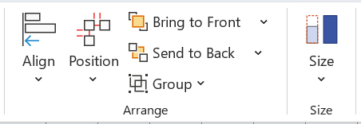
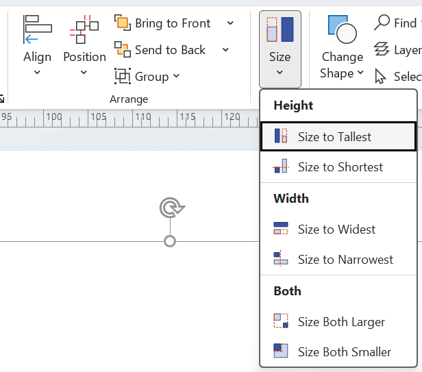

# Visio Size Tools

A COM add-in for Microsoft Visio that makes selected shapes the same height, width or size, the way
PowerPoint's *Size* commands do. It adds a **Size** menu to **Home**, right after the **Arrange** group:





Select two or more shapes to enable the menu. Connectors and other 1-D shapes are ignored, and shapes
with locked or guarded width/height are skipped (you'll be told how many). Each command is a single
undo step.

## Commands

In each example the three shapes were selected in the order **1, 2, 3**. Every image is produced by
clicking the add-in's own menu items (see [Regenerating the screenshots](#regenerating-the-screenshots)).

**Starting point**


| Command | Result |
|---|---|
| **Size to Tallest**: every shape gets the height of the tallest |  |
| **Size to Shortest**: every shape gets the height of the shortest |  |
| **Size to Widest**: every shape gets the width of the widest |  |
| **Size to Narrowest**: every shape gets the width of the narrowest |  |
| **Size Both Larger**: the largest width *and* the largest height |  |
| **Size Both Smaller**: the smallest width *and* the smallest height |  |

**Size to First: Height** and **Size to First: Width** set every shape to the height or width of the
first shape you selected, whether that makes the others larger or smaller.

Shapes resize about their centre (pin), as they do when you type a new size into Visio's Size &amp; Position window.

### Hold Shift to also align

Hold **Shift** while you choose a command to also line the shapes up with the **first shape you
selected**: bottoms for the height commands, left edges for the width commands, and bottom-left
corners for the *Both* commands.

| Command | Result |
|---|---|
| **Shift + Size to Tallest**: bottoms aligned to shape 1 |  |
| **Shift + Size to Shortest**: bottoms aligned to shape 1 |  |

## Install

Download `VisioSizeTools_Setup_x.y.z.exe` from the
[latest release](../../releases/latest) and run it, then restart Visio.

- Installs for the current user only, with no admin rights, into `%LOCALAPPDATA%\Programs\VisioSizeTools`.
- Works with 32- and 64-bit Visio 2013 or later. Needs .NET Framework 4.8, which is part of Windows 10 and 11.
- Uninstall from **Settings → Apps** in the usual way.

## Build

Everything goes through the `Makefile` (GNU make from Git Bash; `choco install make` if you don't have it):

| Command | What it does |
|---|---|
| `make build` | Release build (`CONFIGURATION=Debug` or `make debug` for a Debug build) |
| `make installer` | Build plus the Inno Setup installer in `artifacts/` |
| `make register` / `make unregister` | Register the local build with Visio for the current user, or remove it |
| `make screenshots` (or `make readme`) | Regenerate the README images; see below |
| `make version` | Interactively bump and tag the release version (see [Releases](#releases)) |
| `make clean` | Remove `bin/`, `obj/` and `artifacts/` |

Run `make` on its own to list them. Plain `dotnet build VisioSizeTools.sln -c Release` works too.

Builds are stamped from `git describe` (for example `v0.2.0-3-gabc123-dirty`): the assembly gets the numeric
part (`0.2.0`) and the full string goes into the informational version and the installer name.
Override it with `make installer VERSION=v1.2.3`.

The project targets .NET Framework 4.8 because Visio loads COM add-ins in-process through the .NET Framework
loader (`mscoree.dll`). The Office interop assemblies are vendored in `lib\`, so you don't need Office to build;
their types are embedded, so nothing from `lib\` ships.

`make register` runs `scripts\Register.ps1`, which points Visio at `bin\Release` (or `bin\Debug`) under HKCU,
so you can try a build without installing it. Debug builds write a trace to `%LOCALAPPDATA%\VisioSizeTools.log`.

The installer script is `installer\VisioSizeTools.iss` ([Inno Setup 6](https://jrsoftware.org/isinfo.php)).
If ISCC isn't in the default location, pass `ISCC=<path to ISCC.exe>`.

## Releases

Releases are a deliberate act, cut from a tag:

```bash
make version              # shows the current version, pick patch / minor / major / custom, tags HEAD locally
git push origin main
git push origin vX.Y.Z    # this is what triggers the release
```

Pushing a `vX.Y.Z` tag runs `.github/workflows/release.yml`. It runs `make installer VERSION=vX.Y.Z` on a
Windows runner and publishes a GitHub Release with the installer, `SHA256SUMS.txt`, and notes listing this
release's commits and the 35 most recent. Ordinary pushes don't build anything.

## Regenerating the screenshots

Every image in `docs/images` comes from `scripts\Capture-Screenshots.ps1`. It starts its own Visio instance,
draws the demo shapes and clicks each **Size** menu item through UI Automation, so the pictures always show
what the shipped code does. It saves the ribbon and menu as screen grabs and exports the before/after pictures
from the page.

```bash
make screenshots      # or: powershell -ExecutionPolicy Bypass -File scripts\Capture-Screenshots.ps1
```

- Visio and the add-in must be installed (or registered with `scripts\Register.ps1`). Visio can't run on
  CI runners, so this is a local step: rerun it and commit `docs/images` when the ribbon or behaviour changes.
- Close Visio first. The script refuses to attach to a Visio that's already open.
- It takes about 30 seconds. Leave the mouse and keyboard alone: the screen grabs need the Visio window in front,
  and Shift is pressed for the align examples.
- Each step has a 10-second watchdog. If Visio stops responding, the script closes the instance it started
  and fails with the name of the step that stalled.

## Repository layout

```
Makefile                   local build, installer, screenshots, version tagging
VisioSizeTools.sln
src/VisioSizeTools/        add-in source (ribbon XML, icons drawn at runtime, size operations)
lib/                       Office 15 interop assemblies (build-time only)
installer/                 Inno Setup script
scripts/                   Register / Unregister / Capture-Screenshots
docs/images/               README images (generated)
.github/workflows/         CI build and release
```
